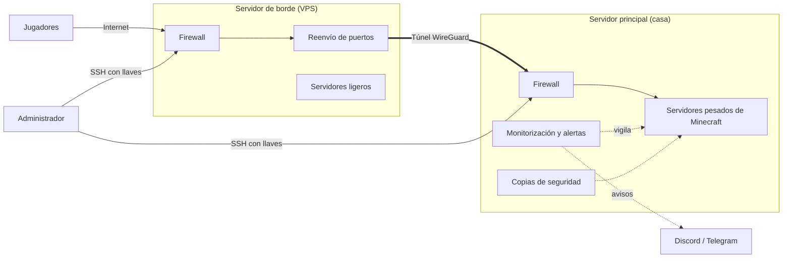

# Minecraft Edge Infra

Infraestructura reproducible para alojar servidores de Minecraft desde casa **sin exponer tu IP**, con seguridad, monitorización y copias de seguridad incluidas.

> Estado: esqueleto inicial. Los roles se irán implementando uno a uno.

## La idea

Los jugadores nunca hablan con tu casa. Se conectan a un servidor en la nube, que reenvía el tráfico por un túnel privado hacia el servidor principal.



## Principios

- **Exposición mínima:** todo cerrado por defecto; solo se abre lo necesario.
- **Casa invisible:** su IP nunca aparece públicamente.
- **Todo como código:** un solo comando prepara un servidor desde cero.
- **Nada secreto en el repositorio:** los datos reales viven fuera.

## Estructura

| Carpeta | Contenido |
|---|---|
| `inventory/` | Lista de servidores (solo un ejemplo se sube) |
| `group_vars/` | Configuración personalizable |
| `playbooks/` | Orden en que se aplican los roles |
| `roles/` | Cada pieza del sistema por separado |
| `docs/` | Decisiones, problemas resueltos y guía de fallos |

## Uso (cuando esté terminado)

```bash
cp inventory/example.yml inventory/produccion.yml
cp group_vars/all.example.yml group_vars/all.yml
# edita ambos con tus datos
ansible-playbook -i inventory/produccion.yml playbooks/site.yml
```

## Más información

- [Decisiones de diseño](docs/decisiones.md)
- [Problemas resueltos](docs/problemas-resueltos.md)
- [Solución de problemas](docs/solucion-de-problemas.md)
